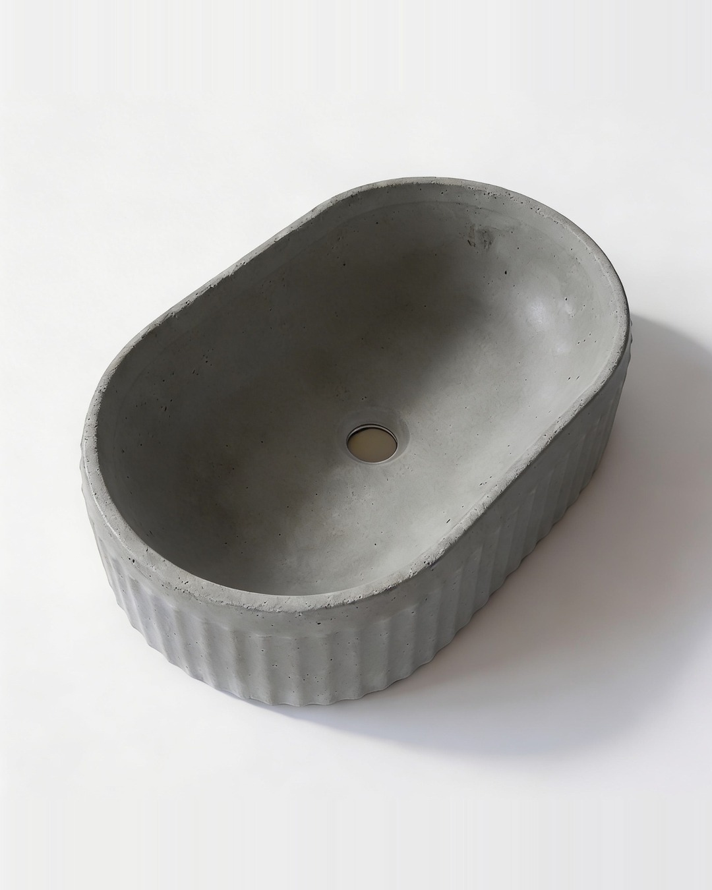
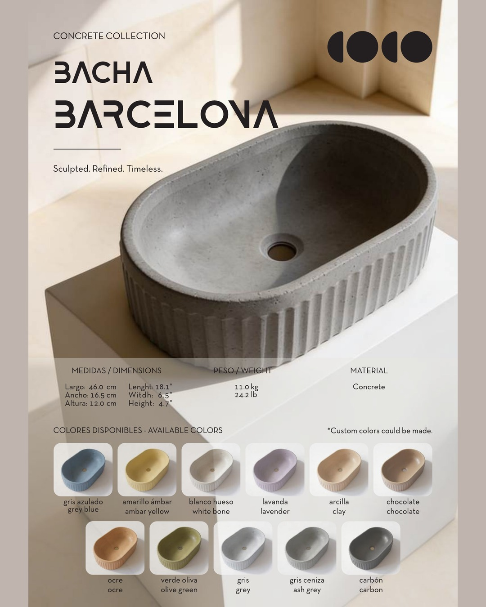
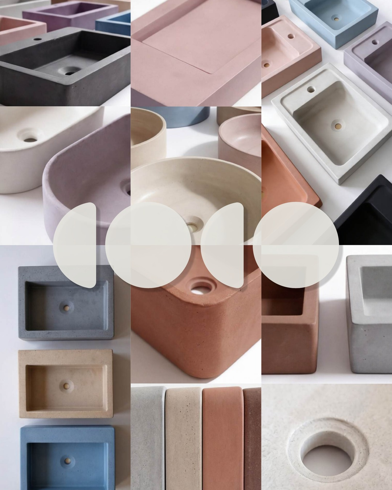
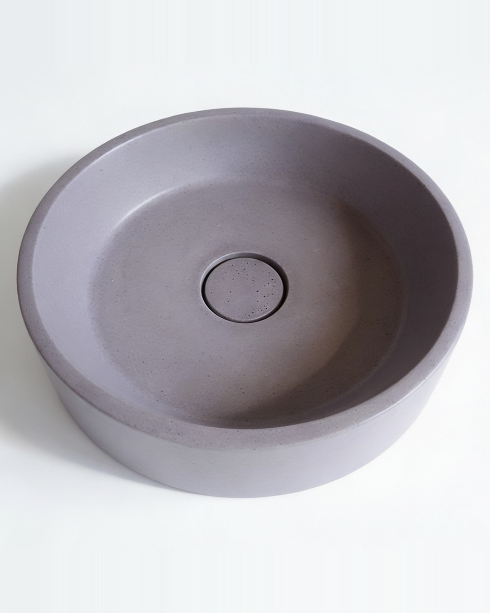
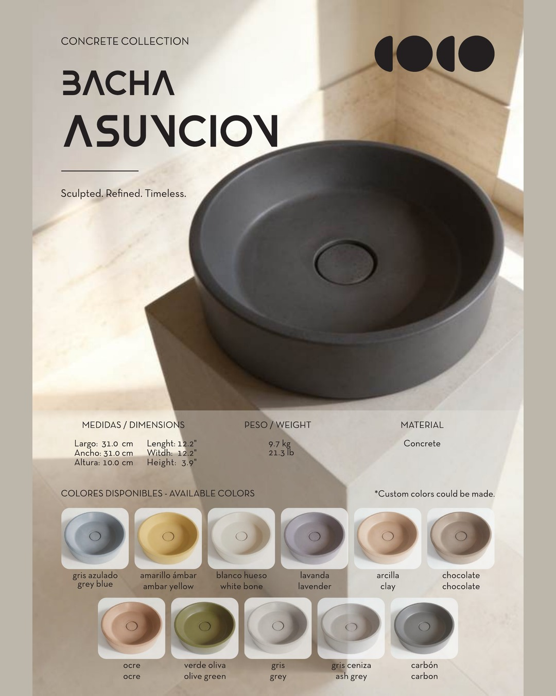
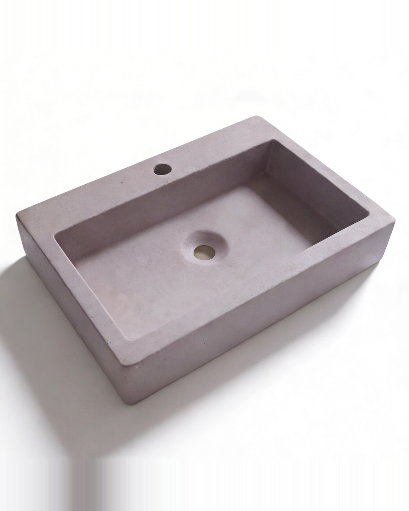
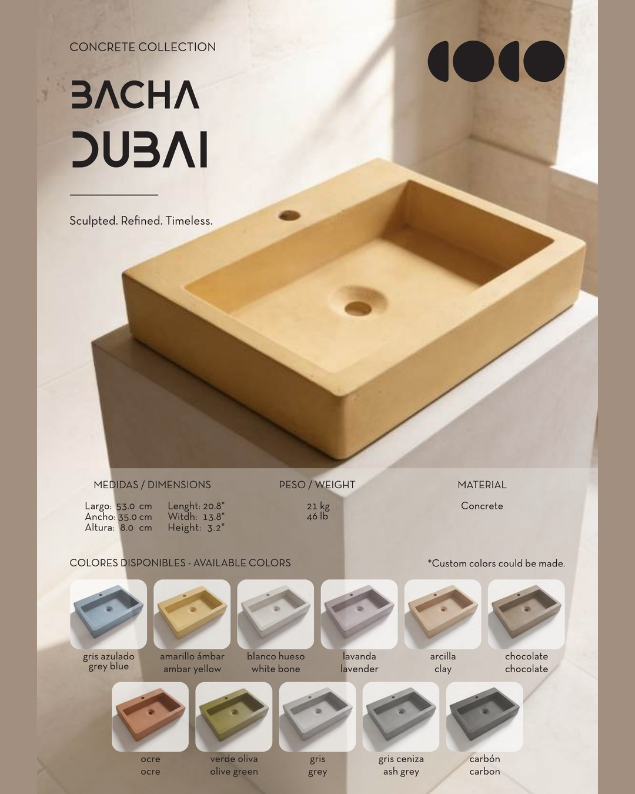
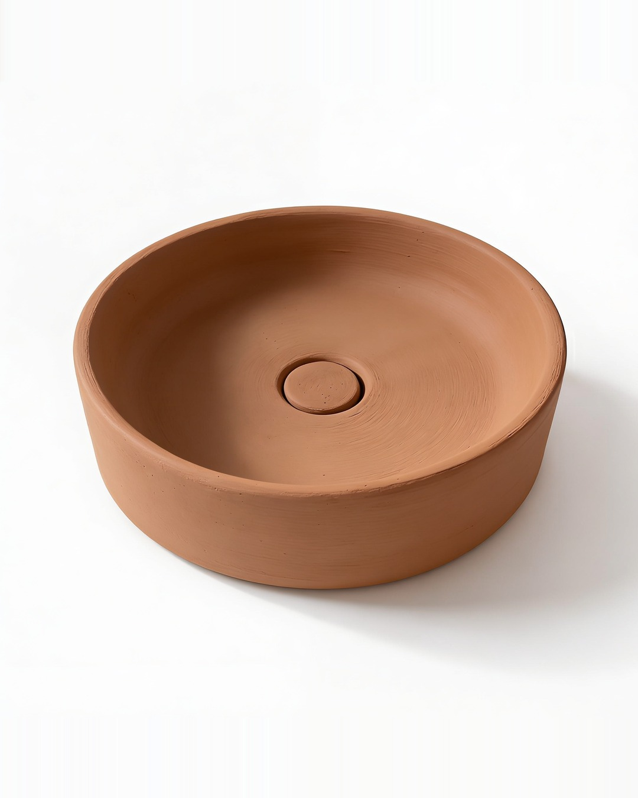
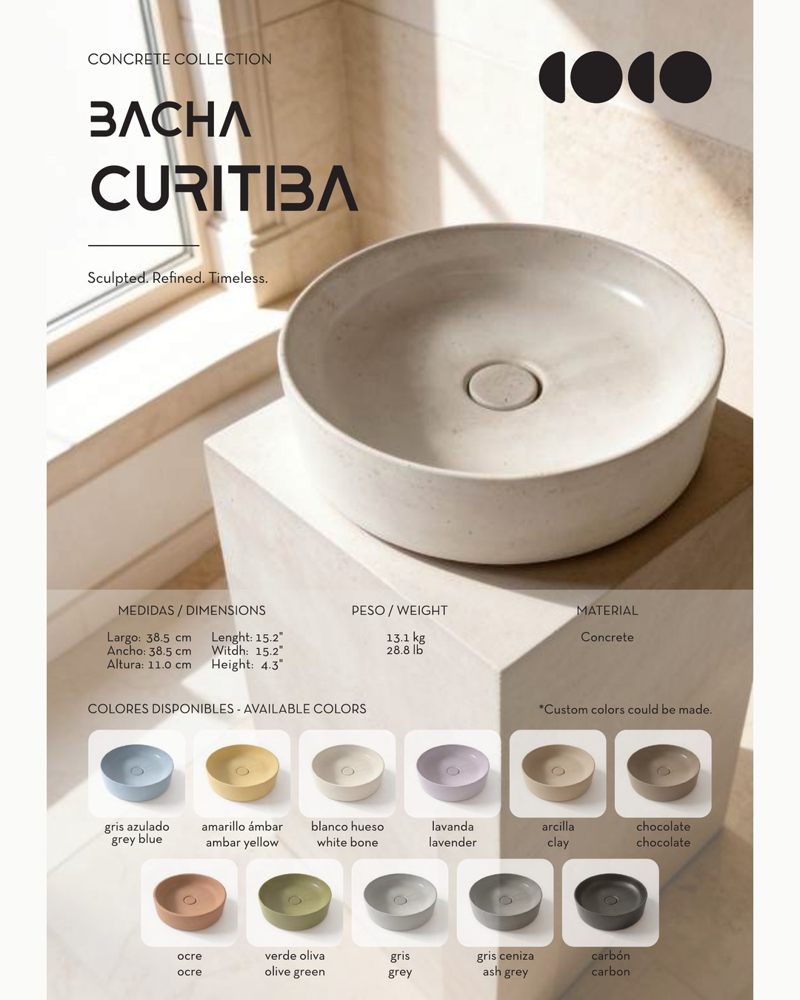
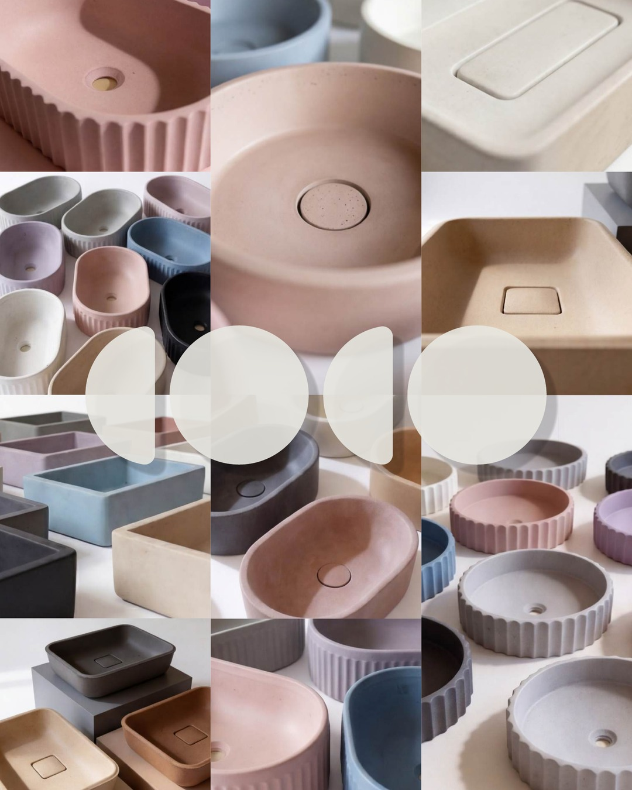

# COCO · Semana 01 · lunes 16 al sábado 21 de noviembre

Seis posteos listos para aprobar. Cada uno trae sus imágenes (1080 × 1350, formato 4:5) y el texto para copiar.

**Cómo aprobar:** marcá cada día con OK o decime qué cambiar. Los aprobados se programan en Meta Business Suite (Planificador), todos juntos, una sola vez por semana.

**Antes de publicar, confirmá:** el ancho de la Bacha Barcelona figura como 16,5 cm en el catálogo. Si es un error de tipeo, corregilo también en el PDF.

---

## Lunes 16 · Bacha Barcelona (carrusel, 2 imágenes)

 

```
Barcelona. Estrías marcadas a mano, 46 cm de largo, 11 kg de concreto.

Una bacha que no se esconde: se apoya sobre la mesada y define el baño entero.

Disponible en 11 colores, o en el tono que tu proyecto necesite.

Diseñada y fabricada en Paraguay.
Escribinos "BARCELONA" por mensaje y te pasamos precio y plazo de entrega.

#cococoncrete #bachadeconcreto #diseñoparaguayo #baños #arquitecturaparaguay
```

---

## Martes 17 · Los 11 colores (1 imagen)



```
11 colores. El mismo concreto.

Gris azulado, ámbar, blanco hueso, lavanda, arcilla, chocolate, ocre, verde oliva, gris, gris ceniza y carbón.

El color va en la masa, no pintado encima. ¿Tu proyecto pide otro tono? Lo hacemos a medida.

¿Cuál elegirías para tu baño? Contanos en los comentarios.

#cococoncrete #concreto #interiorismo #diseñoparaguayo #bachas
```

---

## Miércoles 18 · Bacha Asunción (carrusel, 2 imágenes)

 

```
Le pusimos el nombre de casa: Asunción.

Redonda, 31 cm de diámetro, con tapa de desagüe del mismo concreto. Nada interrumpe la forma.

Cada bacha de COCO lleva el nombre de una ciudad del mundo. Esta es la nuestra.

Hecha en Paraguay.
Escribinos "ASUNCIÓN" por mensaje y te pasamos precio y colores disponibles.

#cococoncrete #asuncion #hechoenparaguay #bachadeconcreto #diseñoparaguayo
```

---

## Jueves 19 · Bacha Dubai (carrusel, 2 imágenes)

 

```
21 kilos de concreto en una sola pieza.

Dubai mide 53 × 35 cm y trae el orificio para la grifería integrado. Se apoya sobre la mesada y queda lista para conectar.

Arquitectos e interioristas: armamos presupuestos por proyecto, con color y cantidad a medida.

Escribinos "DUBAI" por mensaje y coordinamos.

#cococoncrete #arquitecturaparaguay #interiorismo #bachadeconcreto #obra
```

---

## Viernes 20 · Bacha Curitiba (carrusel, 2 imágenes)

 

```
Curitiba en color arcilla.

38,5 cm de diámetro, 11 cm de alto, tapa de desagüe a tono. Un color cálido para baños de madera, piedra y luz natural.

¿La imaginás en otro tono? Tenemos 11 colores y hacemos el tuyo a pedido.

Escribinos "CURITIBA" por mensaje y te pasamos precio.

#cococoncrete #bachadeconcreto #baños #diseñodeinteriores #hechoenparaguay
```

---

## Sábado 21 · El catálogo (1 imagen)



```
24 bachas. 24 ciudades. 11 colores.

Todo el catálogo COCO en un solo PDF, con medidas, pesos y colores de cada modelo.

Escribinos "CATÁLOGO" por mensaje y te lo mandamos hoy.

Diseño en concreto, desde Paraguay.

#cococoncrete #catalogo #bachadeconcreto #diseñoparaguayo #arquitecturaparaguay
```
